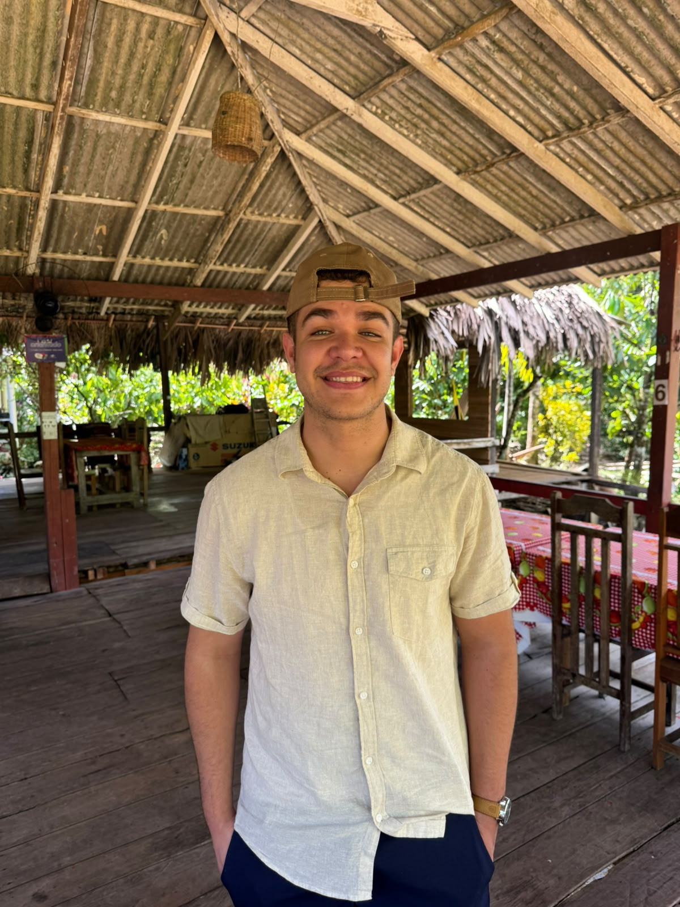
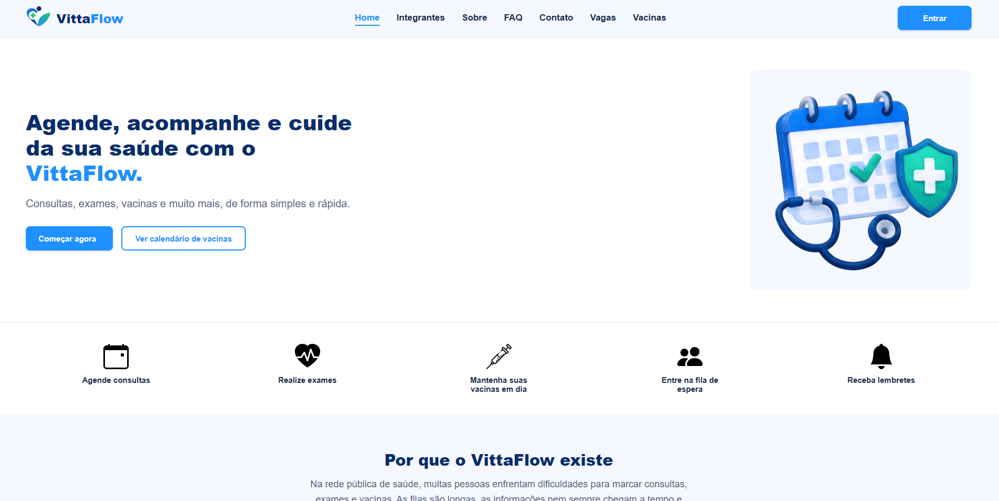
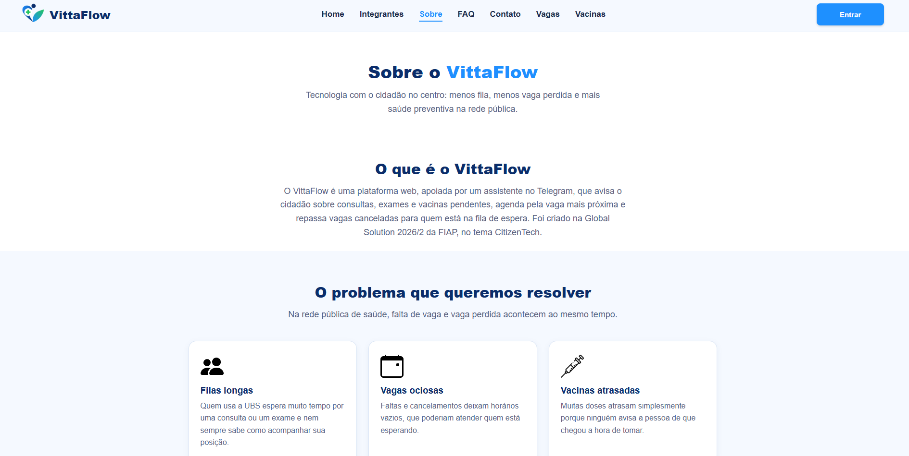
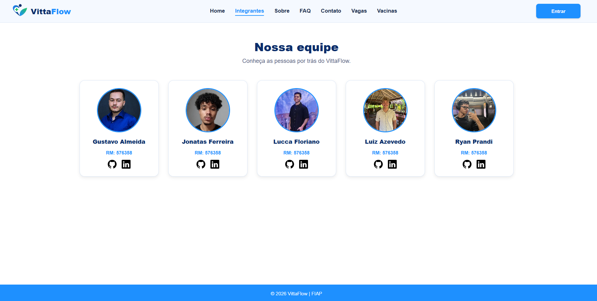
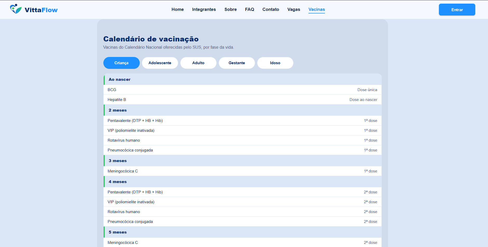
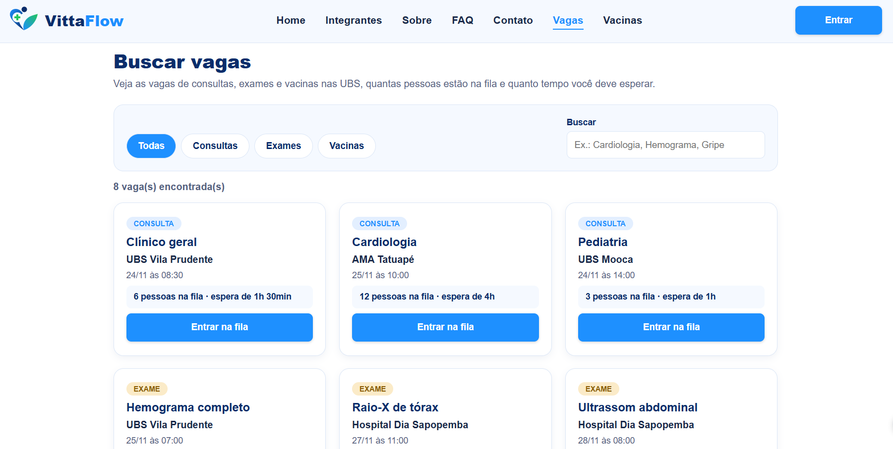
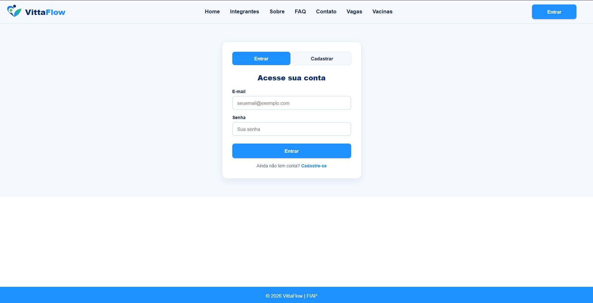
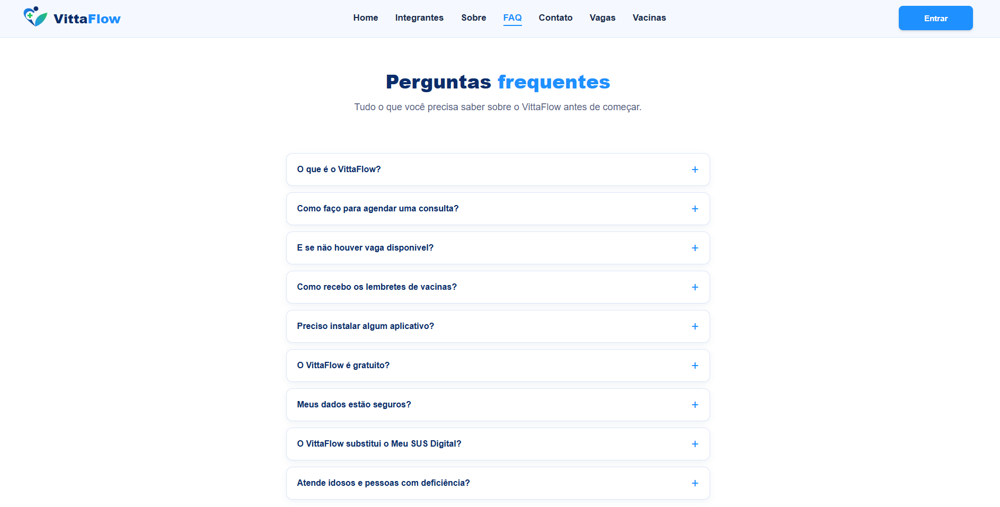
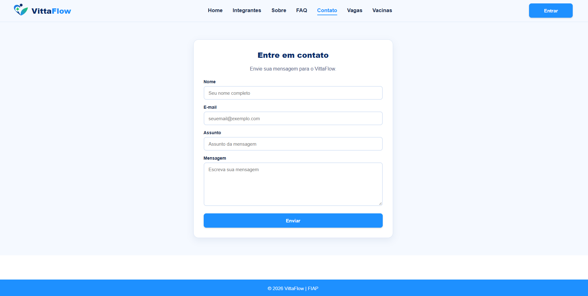

<div align="center"> 
  # VittaFlow
  
</div

<br>
> Projeto desenvolvido para a Global Solution - FIAP, CitizenTech

---

## 📌 Sumário

1. [Título e Descrição](#-1-título-e-descrição)
2. [Problema Abordado e Solução](#-2-problema-abordado-e-solução)
3. [Tecnologias Utilizadas](#-3-tecnologias-utilizadas)
4. [Estrutura de Pastas do Projeto](#-4-estrutura-de-pastas-do-projeto)
5. [Integrantes](#-5-integrantes)
6. [Imagens e Páginas do Projeto](#-6-imagens-e-páginas-do-projeto)
7. [Link do Repositório do GitHub](#-7-link-do-repositório-do-github)
8. [Contato](#-8-contato)

---

## 📖 1. Título e Descrição

O **VittaFlow** é uma plataforma web voltada para facilitar o agendamento e o acompanhamento de consultas, exames e vacinas na rede pública de saúde. A proposta é oferecer uma experiência simples e acessível para que os usuários encontrem vagas, entrem em filas de espera, acompanhem sua caderneta de vacinas e recebam lembretes importantes.

O projeto apresenta informações sobre a solução, seus objetivos e a equipe, além de páginas voltadas a funcionalidades como busca de vagas, calendário de vacinas, login/cadastro e canais de contato.

---

## 💡 2. Problema Abordado e Solução

- **Problema:** Na rede pública de saúde, muitas pessoas enfrentam filas longas para consultas, exames e vacinas, enquanto vagas podem ficar ociosas por faltas e cancelamentos. Além disso, atrasos na vacinação são comuns quando não há lembretes ou acompanhamento adequado.
- **Solução:** O VittaFlow propõe uma interface web que centraliza o acesso a agendamentos, fila de espera, reaproveitamento de vagas canceladas e acompanhamento da caderneta vacinal, ajudando a tornar o cuidado com a saúde mais organizado, acessível e eficiente.

### Objetivos da solução
- Facilitar o agendamento de consultas, exames e vacinas.
- Reduzir o desperdício de vagas por meio de fila de espera e reaproveitamento de cancelamentos.
- Apoiar o cuidado preventivo com informações e lembretes sobre vacinação e atendimentos.

### Proposta desenvolvida pela equipe
A equipe desenvolveu uma solução focada em usuários da rede pública (UBS), com atenção especial a idosos, gestantes e pessoas com deficiência, buscando promover organização, prevenção e inclusão no acesso aos serviços de saúde.

---

## 🚀 3. Tecnologias Utilizadas

- **HTML5 Semântico:** Estruturação das páginas com elementos como `<header>`, `<nav>`, `<main>`, `<section>` e `<footer>`.
- **CSS3:** Estilização da interface, responsividade e componentes visuais do projeto.
- **JavaScript:** Interatividade da aplicação (menu mobile e funcionalidades das páginas, como login/cadastro e calendário de vacinas).
- **Git e GitHub:** Versionamento, colaboração e controle de histórico do código.

---

## 📁 4. Estrutura de Pastas do Projeto

```text
VittaFlow/
├── assets/
│   ├── icons/
│   └── img/
├── css/
│   ├── contato.css
│   ├── faq.css
│   ├── integrantes.css
│   ├── login.css
│   ├── sobre.css
│   ├── style.css
│   └── vacinas.css
├── js/
│   ├── contato.js
│   ├── login.js
│   ├── sobre.js
│   ├── script.js
│   └── vacinas.js
├── contato.html
├── faq.html
├── index.html
├── integrantes.html
├── login.html
├── sobre.html
├── vacinas.html
├── vagas.html
└── README.md
```

---

## 👥 5. Integrantes

<div align="center">

| Foto | Nome Completo | RM | Turma | Redes / Links |
| :---: | :---: | :---: | :---: | :---: |
|  | Gustavo Almeida | 576039 | 1TDSPR | [GitHub](https://github.com/goliveiraalmeida) / [LinkedIn](https://www.linkedin.com/in/goliveiraalmeida) |
|  | Jonatas Ferreira | 576943 | 1TDSPR | [GitHub](https://github.com/jonatazf) / [LinkedIn](https://www.linkedin.com/in/jonatazf/) |
|  | Lucca Floriano | 575494 | 1TDSPR | [GitHub](https://github.com/luccafloriano-7) / [LinkedIn](https://www.linkedin.com/in/lucca-floriano) |
|  | Luiz Azevedo | 575245 | 1TDSPR | [GitHub](https://github.com/lazevedo2000-sudo) / [LinkedIn](https://www.linkedin.com/in/luiz-azevedo-890446235) |
|  | Ryan Prandi | 576358 | 1TDSPR | [GitHub](https://github.com/prandiryan) / [LinkedIn](https://www.linkedin.com/in/ryan-prandi) |

</div>

---

## 🎨 6. Imagens e Páginas do Projeto

<div align="center">

### Home (`index.html`)
<p align ="left">Apresentação da solução, funcionalidades, funcionamento e chamada para ação.</p>



</div>


<div align="center">

### Sobre (`sobre.html`)
<p align ="left">Descrição do projeto, problema abordado, objetivo, proposta da equipe e ODS.<p>



</div>


<div align="center">

### Integrantes (`integrantes.html`)
<p align ="left">Informações da equipe e links de contato profissional.<p>



</div>


<div align="center">

### Vacinas (`vacinas.html`)
<p align ="left">Calendário de vacinação por faixa etária.<p>



</div>


<div align="center">

### Vagas (`vagas.html`)
<p align ="left">Página destinada à busca/acompanhamento de vagas de atendimento.<p>



</div>


<div align="center">

### Login (`login.html`)
<p align ="left">Acesso à conta e cadastro de novos usuários.<p>



</div>


<div align="center">

### FAQ (`faq.html`)
<p align ="left">Perguntas frequentes e dúvidas sobre a plataforma.<p>



</div>


<div align="center">

### Contato (`contato.html`)
<p align ="left">Formulário de suporte e informações complementares.<p>



</div>


---

## 🔗 7. Link do Repositório do GitHub

Acesse o código-fonte e o histórico de commits do projeto:

👉 [**Repositório no GitHub**](https://github.com/LosCraquitos/VittaFlow)

---

## ✉️ 8. Contato

- **Repositório / Issues:** [Abrir uma issue no GitHub](https://github.com/LosCraquitos/VittaFlow/issues)
- Para contato com os integrantes, utilize os links de GitHub e LinkedIn informados na seção [Integrantes](#-5-integrantes).

---

**VittaFlow**  
